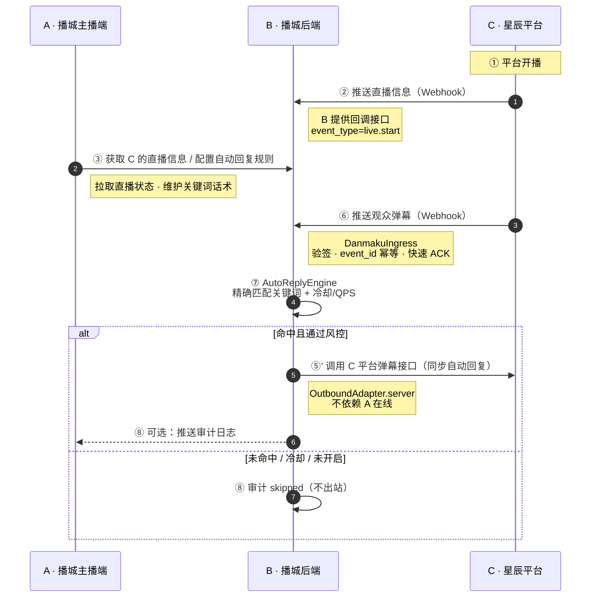
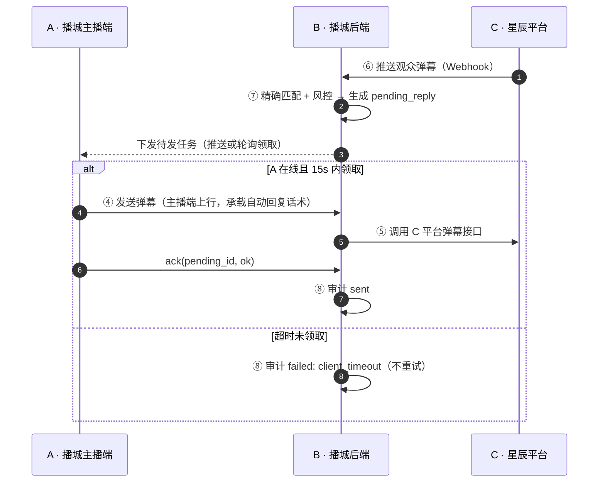

# 弹幕自动回复设计（星辰 × 播城）

**日期：** 2026-11-20  
**状态：** 需按代理商接口文档修订（原「C→B Webhook 入站」假设已推翻）  
**范围：** 在 OEM 弹幕 HTTP 对接契约下，以**代理商**身份实现「观众弹幕 → 自动固定话术回复」  
**接口依据：** [弹幕 HTTP 对接文档](https://docs.apipost.net/docs/detail/732230de0472000?locale=zh-cn&target_id=32229200b12005)（项目：oem弹幕）

## 1. 背景与目标

现有时序仅支持：

1. 星辰开播 → 回调 B 推送直播信息  
2. A 从 B 拉取直播状态  
3. A 上行弹幕 → B 调用星辰弹幕接口同步  

该链路是**主播端上行单向同步**，无法完成自动回复。自动回复需要：**观众弹幕入站 → 决策 → 出站发弹幕**。

### 1.1 目标（MVP）

- 星辰通过 Webhook 将观众弹幕推送到 B  
- B 对弹幕做**关键词精确匹配**，命中后发送**固定话术**  
- 出站通过可插拔适配器：优先服务端代发；无凭证时降级主播端代发  
- 具备基础冷却、直播间限流、幂等与审计  

### 1.2 非目标（首期不做）

- LLM / 语义理解生成回复  
- 模糊匹配、正则、同义词  
- FAQ 多轮或优先级复杂编排（仅保留简单 priority 字段以备扩展）  
- 跨平台统一机器人抽象  
- 礼物 / 进场等非弹幕事件自动回复  

## 2. 已锁定决策

| 议题 | 结论 | 文档对照后 |
|------|------|------------|
| 身份 | （原未显式） | **我方 = 代理商**（实现监听侧 3 接口，并向平台推弹幕） |
| 入站 | ~~星辰 Webhook 推观众弹幕到 B~~ | **推翻**：观众弹幕由代理商从源直播间监听获得，再 `POST` 给平台 |
| 出站回源直播间 | `OutboundAdapter` server/client | **本文档未覆盖**：无「向源平台发弹幕」接口；自动回复出站需另证 |
| 回复能力 | 关键词精确匹配 → 固定话术 | **仍有效**（MVP 能力不变） |
| 鉴权 | （原假定签名/Token） | **IP 双向白名单**；`code:1/0` 业务码；无 Token |

## 3. 架构

### 3.1 模块

| 模块 | 职责 |
|------|------|
| `DanmakuIngress` | 接收星辰 Webhook；验签；按 `event_id` 幂等；落库；异步投递引擎 |
| `AutoReplyEngine` | 读取直播间配置与规则；精确匹配；冷却/限流；生成待发回复 |
| `OutboundAdapter` | 统一出站：`ServerSend` 或 `ClientRelay` |
| `ReplyAuditLog` | 记录触发、跳过、成功、失败原因；可选推给 A |

### 3.2 最终版时序图

参与方与原稿一致：A 播城主播端 · B 播城后端 · C 星辰平台。  
①–③、⑤ 沿用；④ 保留为人工/client 代发；**新增 ⑥ 入站、⑦ 决策、⑧ 审计**；自动回复出站为 ⑤'（server）或 ④→⑤（client）。

#### 主路径（outbound_mode = server | auto 且有凭证）



#### 降级路径（outbound_mode = client，或 auto 无凭证）



#### 步骤对照（相对原图）

| 步骤 | 方向 | 动作 | 相对原图 |
|------|------|------|----------|
| ① | C | 平台开播 | 沿用 |
| ② | C→B | 推送直播信息 | 沿用（可按 event_type 扩展） |
| ③ | A→B | 拉取直播状态 / 配置规则 | 扩展 |
| ⑥ | C→B | 推送观众弹幕 | **新增（关键）** |
| ⑦ | B | 匹配 + 风控 | **新增** |
| ⑤' | B→C | 服务端代发自动回复 | 复用⑤ |
| ④→⑤ | A→B→C | client 降级代发 | 沿用④⑤语义 |
| ⑧ | B（→A） | 审计日志 | **新增** |

步骤④ 同时用于**人工弹幕**与 **client 代发**；`server` 模式下自动回复不依赖 A 在线。
## 4. 入站：Webhook

### 4.1 约定字段

| 字段 | 类型 | 说明 |
|------|------|------|
| `event_id` | string | 全局唯一；幂等键；必填 |
| `event_type` | string | 例：`live.start`、`danmaku.message` |
| `room_id` | string | 星辰直播间 ID，映射播城场次 |
| `user_id` | string | 观众平台 UID |
| `nickname` | string | 可选，审计展示 |
| `content` | string | 弹幕原文 |
| `ts` | int64 | 平台毫秒/秒时间戳；与 B 时钟差超过阈值（默认 5 分钟）则丢弃并记审计 |
| `sign` | string | 按星辰约定验签（如 HMAC-SHA256 over body + timestamp） |

字段名若与星辰文档不一致，以星辰文档为准，B 侧做适配映射；语义不变。

### 4.2 处理原则

1. 验签失败：HTTP 401，不落库  
2. 重复 `event_id`：HTTP 200，不重复投递引擎  
3. 未知 `event_type`：HTTP 200，忽略业务  
4. 合法弹幕事件：先持久化再 HTTP 200，异步调用引擎（避免回调超时）  
5. 仅处理已映射且「开播中」的 `room_id`；否则记 `skipped: not_live`  

## 5. 规则与匹配

### 5.1 数据模型

**auto_reply_config**（每直播间或每主播一条）

| 字段 | 说明 | 默认 |
|------|------|------|
| `room_id` / `streamer_id` | 作用域 | — |
| `enabled` | 总开关 | `false` |
| `cooldown_user_sec` | 同用户冷却 | `60` |
| `cooldown_room_qps` | 直播间出站上限 | `1` 条/秒 |
| `outbound_mode` | `server` \| `client` \| `auto` | `auto` |

**auto_reply_rule**

| 字段 | 说明 |
|------|------|
| `id` | 规则 ID |
| `room_id` | 所属直播间 |
| `keyword` | 精确匹配关键词 |
| `reply` | 固定话术 |
| `priority` | 整数，越大优先；同 priority 取 `id` 较小者 |
| `enabled` | 是否启用 |

配置由 A 经 B 的管理 API 维护（CRUD + 开关）；变更立即对后续事件生效（进程内缓存 TTL ≤ 5s 可接受）。

### 5.2 匹配算法（确定性）

对 `content`：

1. 若发送方标记为自动回复/主播代发（见 §6.3），**不匹配**（防自回环）  
2. `normalized = trim(content)`（首期不做全半角折叠；若后续需要须另开变更）  
3. 在该 `room_id` 下取所有 `enabled=true` 的规则，找 `keyword == normalized`  
4. 多条命中时取 `priority` 最大的一条；仍并列则取 `id` 最小  
5. 无命中 → 审计 `skipped: no_match`，不出站  

## 6. 出站：OutboundAdapter

### 6.1 模式

| 模式 | 条件 | 路径 |
|------|------|------|
| `server` | 配置为 server，且 B 持有有效发弹幕凭证 | B → C 调用现有弹幕接口⑤ |
| `client` | 配置为 client，或 auto 降级 | B 写入 `pending_reply`；A 长连接或短轮询领取后走原④⑤ |
| `auto` | 默认 | 有可用凭证则 `server`，否则 `client` |

「可用凭证」定义：该 `room_id` 在 B 侧存在未过期的星辰发弹幕 token/签名材料，且最近一次探测或实发未返回「权限拒绝」。

### 6.2 client 模式时序

1. 引擎产生待发：`pending_id`, `room_id`, `reply`, `expire_at`（默认 now+15s）  
2. A 在线则推送；否则等 A 轮询  
3. A 成功走④⑤后回调 B `ack(pending_id, ok)`  
4. 超时未 ack：标记 `failed: client_timeout`，**不自动重试**（避免补发刷屏）  

### 6.3 自回环过滤

凡经 `OutboundAdapter` 发出的内容，在本地审计中标记 `outbound=true`，并在调用星辰时尽量带上平台支持的 bot/系统标记。若 Webhook 回推自己的弹幕：优先用平台 `msg_source`/`is_bot` 字段过滤；若无，则用「短时间窗口 + 内容哈希 + room」近似去重（窗口默认 10s）。

## 7. 风控与审计

### 7.1 限流

按顺序检查，任一不通过则不出站：

1. `enabled == false` → `skipped: disabled`  
2. 房间未开播 → `skipped: not_live`  
3. 同 `room_id + user_id` 在 `cooldown_user_sec` 内已成功出站过 → `skipped: user_cooldown`  
4. 房间出站令牌桶超过 `cooldown_room_qps` → `skipped: room_rate_limit`  
5. 话术未通过播城敏感词校验（若已接入）→ `skipped: sensitive`  

冷却键在**成功出站后**写入；`skipped` 与 `failed` 不延长用户冷却（避免一次失败锁死互动）。`room_rate_limit` 导致的跳过可记指标，不重试该事件。

### 7.2 审计字段

`event_id`, `room_id`, `user_id`, `content`, `rule_id`, `keyword`, `reply`, `outbound_mode`, `status`（`sent` \| `skipped` \| `failed`）, `reason`, `created_at`。

主播端可选拉取最近 N 条审计，用于观察自动回复是否正常。

## 8. 错误处理与可运维性

- 星辰发弹幕 5xx / 超时：记 `failed: upstream`，该事件不重试；凭证类 401/403：若模式为 `auto`，将该 room 暂时降级为 `client`（降级缓存默认 5 分钟）  
- Ingress 与引擎解耦：引擎堆积时只影响回复延迟，不影响 Webhook ACK  
- 关键指标：入站 QPS、匹配率、出站成功率、client 超时率、降级次数  

## 9. 测试要点

1. 重复 `event_id` 只处理一次  
2. `trim` 后精确命中；前后空格不影响；子串不命中（「你好呀」不等于「你好」）  
3. 用户冷却与房间 QPS 行为符合默认值  
4. `server` 成功路径；无凭证时 `auto` → `client`；client 超时不重试  
5. 自回环：模拟 Webhook 回推刚发出的回复，不再二次回复  
6. `enabled=false` 与未开播均不出站  

## 10. 实现边界说明

本设计描述播城 B/A 与星辰 C 的集成契约与 B 侧模块职责。当前仓库若尚未包含播城服务代码，实现阶段需在对应服务仓库落地；本 spec 作为跨端契约与验收基准。

## 11. 开放依赖（阻塞自动回复闭环）

1. **向源直播间发送弹幕的能力**不在本 HTTP 对接文档内——必须另有发弹幕 API / 主播端代发 / 源平台账号能力  
2. 自动回复引擎落点：**代理商侧**（监听时本地匹配）还是 **平台侧**（收到 `comments` 后再回）  
3. 源平台监听实现方式（协议/SDK）及是否允许机器人发评  
4. 自回环：发出的自动回复若再次被监听采集，如何用 `msg_id`/账号标记过滤  

## 12. 接口文档对照（代理商身份）

来源：oem弹幕《弹幕 HTTP 对接文档》（ApiPost，2026-11-20）。  
角色约定：文档中「我方服务器」= **平台**；「代理商监听服务」= **本方（代理商）**；「用户」= 开播主播。

### 12.1 角色重映射（相对原 A/B/C 图）

| 原图角色 | 文档角色 | 说明 |
|----------|----------|------|
| C 星辰 / 源平台直播间 | `live_url` 所指源站（如抖音） | 被监听对象，不是 Webhook 推弹幕方 |
| B 播城后端 | 更接近文档「我方服务器」（平台） | 下发开始/停止/重连任务；接收 `comments` |
| （原缺失） | **代理商监听服务** | 本方：实现 tasks 三接口，并向平台推弹幕 |
| A 主播端 | 用户开播入口 + 可选代发 | 文档未描述主播端发弹幕 |

原假设「C→B 推送观众弹幕」与文档**方向相反**：真实弹幕流是 **代理商 → 平台** `POST /api/partner/danmaku/comments`。

### 12.2 代理商必须实现（平台调用本方）

| 方法 | 路径 | 作用 | 关键入参 |
|------|------|------|----------|
| POST | `/api/open/tasks` | 开始监听 | `live_auth_code`, `live_url` |
| POST | `/api/open/tasks/stop` | 停止监听 | `live_auth_code` |
| POST | `/api/open/tasks/reconnect` | 同步重连 | `live_auth_code`, `request_id`（= 触发重连的 `msg_id`） |

同步返回：`{"code":1|0,"msg":"..."}`；HTTP 正常为 200；临时失败可用 503。

### 12.3 平台提供（本方调用平台）

| 方法 | 路径 | 作用 |
|------|------|------|
| POST | `/api/partner/danmaku/comments` | 批量上报普通弹幕与系统通知 |

Body：`{ "comments": [ ... ] }`，每批 1–100 条，建议每 200ms 或满 100 条发送。

普通弹幕关键字段：`live_id`, `nickname`, `msg_type`(`msg|come|follow|like|gift`), `live_auth_code`, `message`, `recv_time`, 可选 `msg_id`。  
系统通知：`msg_type=sys`，`status="-1"` 停止 / `"-2"` 请求平台发起重连；`msg_id` 必填。

### 12.4 对「弹幕自动回复」的含义

| 能力 | 文档是否覆盖 | 结论 |
|------|--------------|------|
| 感知开播 / 建立监听 | ✅ `/tasks` | 可代替原图② 的「开播通知」语义（平台→代理商） |
| 获取观众弹幕 | ✅ 代理商自建监听后上报 | **入站在代理商侧天然具备**；不必等平台 Webhook 弹幕 |
| 关键词匹配回复 | ❌ 业务层 | 仍按 MVP 自建引擎 |
| 把回复发回源直播间 | ❌ | **最大缺口**；无 partner 发弹幕接口 |
| 把回复展示给平台侧 | 可复用 comments？ | 文档未定义 bot 出站类型；不宜擅自当发弹幕用 |

### 12.5 推荐修订架构（代理商视角，待确认引擎落点）

```
用户开播 → 平台 POST /api/open/tasks → 代理商建立监听(live_url)
     ↓
源直播间弹幕 → 代理商采集
     ↓
  ┌──可选 A：代理商本地 AutoReplyEngine（关键词→话术）
  │         → 【缺口】发回源直播间
  │         → 同时 POST comments 上报平台（含观众弹幕；回复是否上报另定）
  └──可选 B：代理商只 POST comments → 平台引擎回复
            → 【缺口】平台/代理商如何把回复打回源直播间
```

鉴权：双向 IP 白名单。会话键：`live_auth_code`（每次开播唯一、不复用）。幂等：系统通知靠 `msg_id`；普通弹幕建议尽量带稳定 `msg_id`。

### 12.6 原 Spec 章节处置

- §3–§6 中「C→B Webhook 入站 / 星辰验签」：**以 §12 为准作废该假设**  
- 「关键词精确匹配 + 冷却/QPS/审计」：**保留**，键改为 `live_auth_code` + 源站 `user`/`nickname` 可用维度  
- `OutboundAdapter`：**保留概念**，但实现依赖「回源发弹幕」能力补充，不能仅靠本对接文档  
