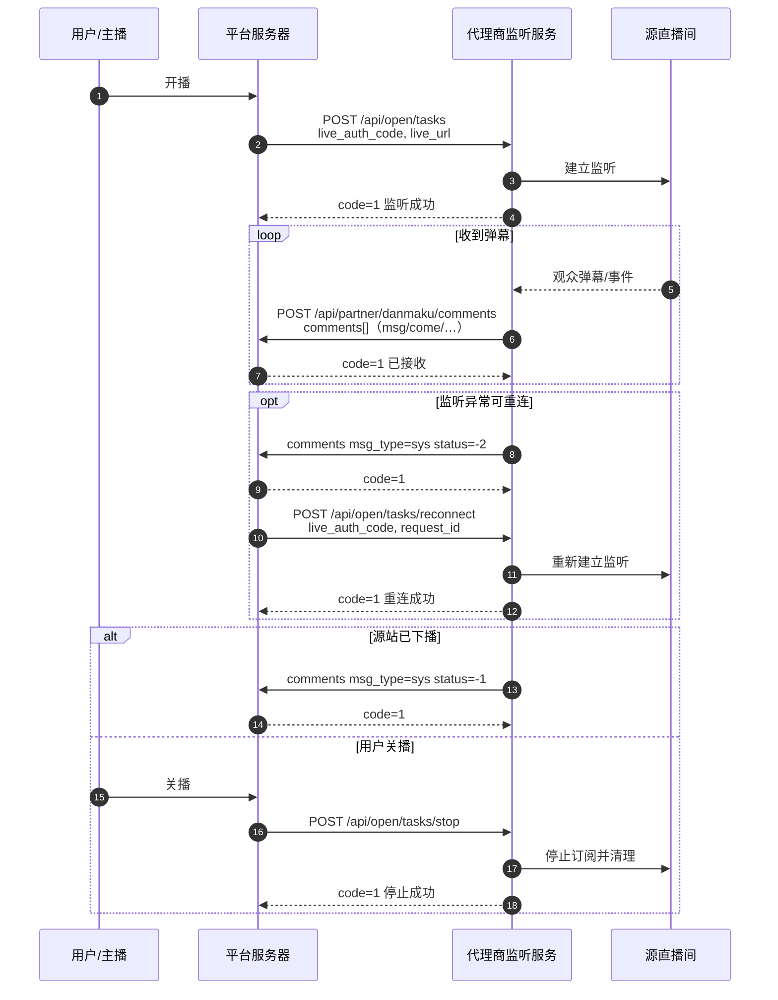
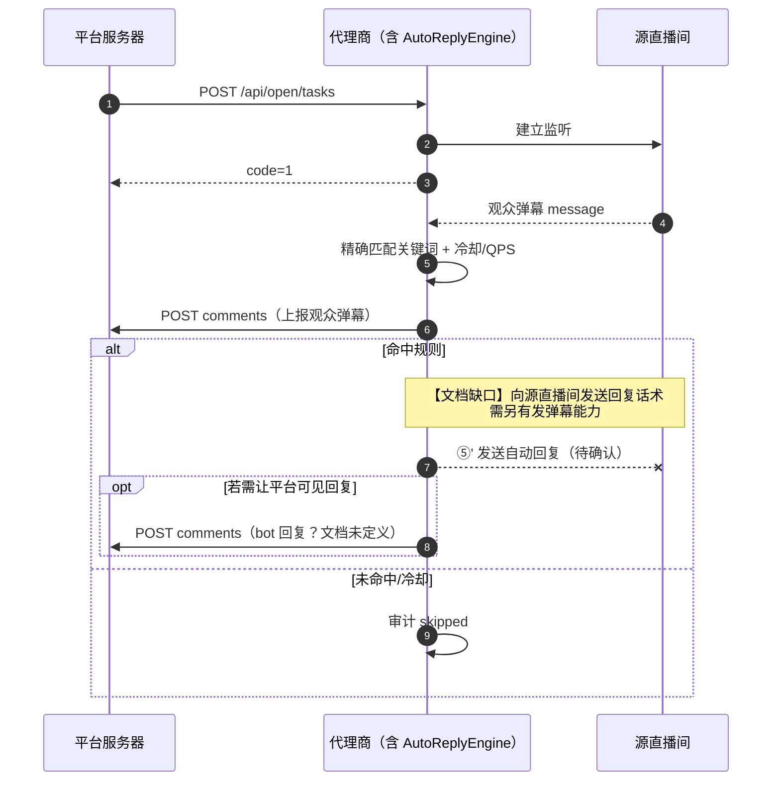

# 弹幕自动回复 · 最终版时序图（代理商身份）

> 依据：[弹幕 HTTP 对接文档](https://docs.apipost.net/docs/detail/732230de0472000?locale=zh-cn&target_id=32229200b12005)  
> 身份：**代理商** = 监听服务；**平台** = 文档「我方服务器」；**源直播间** = `live_url`（如抖音）

## 文档既有对接流程（无自动回复）

## 叠加自动回复（推荐：代理商侧匹配；出站待补齐）

## 步骤对照

| 步骤 | 方向 | 接口/动作 | 自动回复相关 |
|------|------|-----------|--------------|
| 开播任务 | 平台→代理商 | `POST /api/open/tasks` | 会话键 `live_auth_code` |
| 监听采集 | 源站→代理商 | 代理商自建 | **入站在此发生** |
| 上报弹幕 | 代理商→平台 | `POST /api/partner/danmaku/comments` | 上报；非回复出站 |
| 匹配回复 | 代理商内部 | AutoReplyEngine | MVP：精确关键词 |
| 回源发送 | 代理商→源站 | **文档未提供** | 闭环阻塞点 |
| 停止/重连 | 双向 | `/tasks/stop` · `/tasks/reconnect` · `sys±1/±2` | 任务生命周期 |
